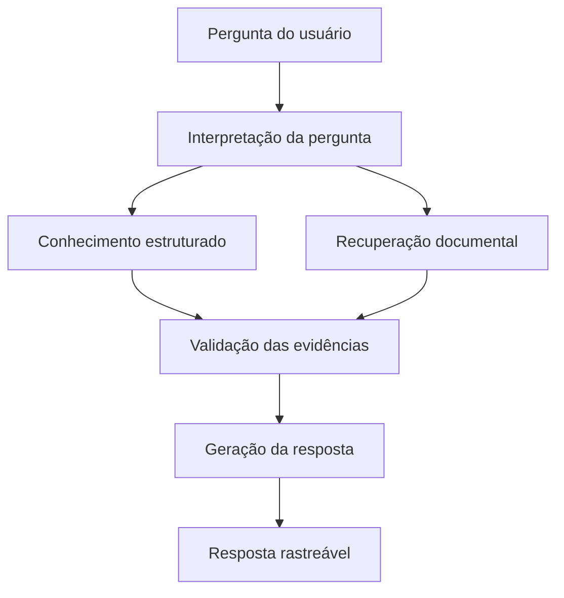

# Arquitetura — Quem Decide?

## Versão
0.1

## Objetivo arquitetural

O Quem Decide? deve responder perguntas sobre competências,
instituições, decisões e processos públicos brasileiros utilizando
informações estruturadas e evidências provenientes de fontes oficiais.

A arquitetura deve permitir que o sistema:

- interprete perguntas em linguagem natural;
- identifique o tema e a intenção da pergunta;
- consulte conhecimento institucional estruturado;
- recupere evidências documentais relevantes;
- diferencie fatos, interpretações e situações ambíguas;
- apresente as fontes utilizadas;
- reconheça quando não possui informação suficiente para responder.

## Princípio central

O modelo de linguagem não deve ser tratado como fonte de conhecimento
institucional.

Sua função será principalmente interpretar a pergunta e auxiliar na
formulação da resposta a partir de informações recuperadas de fontes
controladas pelo sistema.

## Fluxo geral

## Camadas iniciais

### 1. Interface

Recebe a pergunta do usuário e apresenta a resposta.

Na versão inicial, a interface pode ser o próprio terminal.

### 2. Interpretação

Identifica elementos relevantes da pergunta, como:

- tema;
- competência;
- instituição;
- tipo de informação procurada;
- possíveis ambiguidades.

### 3. Conhecimento estruturado

Representa relações institucionais conhecidas pelo sistema.

Exemplos:

- órgão exerce competência;
- órgão pertence a ente federativo;
- competência possui fundamento normativo;
- decisão interpreta ou aplica norma;
- proposição pretende alterar norma;
- proposição possui etapas de tramitação.

### 4. Recuperação documental

Localiza evidências em documentos e páginas oficiais relacionadas
às informações estruturadas.

Exemplos:

- Constituição Federal;
- legislação;
- decisões e publicações de tribunais;
- páginas de tramitação legislativa;
- documentos de órgãos públicos.

### 5. Validação

Verifica se as afirmações necessárias para a resposta possuem
evidências recuperadas pelo sistema.

Informações sem evidência suficiente devem ser sinalizadas como
incertas ou não respondidas.

### 6. Geração da resposta

Transforma os dados estruturados e as evidências recuperadas em
uma explicação compreensível ao cidadão.

A geração não deve alterar o significado das informações recuperadas.

### 7. Rastreabilidade

A resposta deve permitir identificar as fontes que sustentam
as principais afirmações apresentadas.