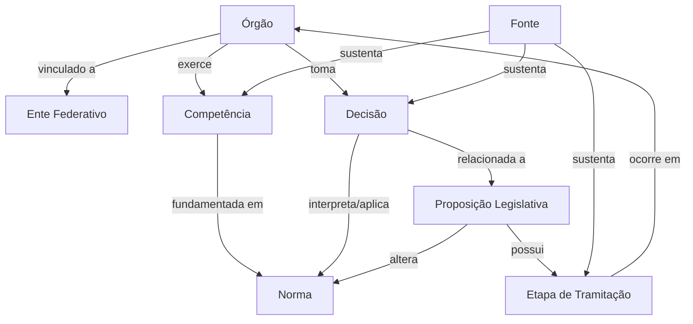

# Modelo de domínio — Quem Decide?

## Objetivo

Representar informações sobre competências, instituições, normas,
decisões e processos públicos brasileiros de forma que seja possível
responder perguntas em linguagem natural com evidências rastreáveis.

## Entidades iniciais

### EnteFederativo

Representa os níveis da Federação.

Exemplos:
- União
- Estado
- Município
- Distrito Federal

### Orgao

Instituição ou órgão público envolvido em uma competência,
decisão ou processo.

Exemplos:
- Polícia Militar
- Polícia Federal
- TSE
- Senado Federal
- CCJ

### Competencia

Atribuição conferida a determinado órgão ou ente.

Exemplos:
- policiamento ostensivo
- patrulhamento de rodovias federais
- investigação criminal

### Norma

Base jurídica relacionada a uma competência ou processo.

Exemplos:
- Constituição Federal
- Lei Complementar nº 64/1990
- Lei nº 13.675/2018

### Decisao

Decisão tomada por uma instituição pública.

Pode possuir:
- órgão responsável;
- data;
- objeto;
- fundamento;
- efeito;
- alcance.

### ProposicaoLegislativa

Proposta submetida ao processo legislativo.

Pode possuir:
- identificador;
- autoria;
- objetivo;
- casa legislativa;
- situação atual.

### EtapaTramitacao

Evento ocorrido durante a tramitação de uma proposição.

Pode possuir:
- data;
- órgão;
- descrição;
- status.

### Fonte

Documento ou página oficial que sustenta determinada informação.

Pode possuir:
- instituição;
- título;
- URL;
- data de consulta;
- tipo de documento.

## Relações iniciais

Um Orgao:
- pertence ou está vinculado a um EnteFederativo;
- exerce uma Competencia;
- pode tomar uma Decisao;
- pode participar de uma EtapaTramitacao.

Uma Competencia:
- é exercida por um ou mais Orgaos;
- possui fundamento em uma ou mais Normas.

Uma Decisao:
- é tomada por um Orgao;
- interpreta ou aplica uma Norma;
- produz determinado efeito;
- pode estar relacionada a uma ProposicaoLegislativa.

Uma ProposicaoLegislativa:
- tramita por diferentes EtapasTramitacao;
- pode alterar uma Norma;
- possui situação atual.

Uma EtapaTramitacao:
- ocorre em determinado Orgao;
- possui uma data;
- altera ou informa o estado da ProposicaoLegislativa.

Uma Fonte:
- sustenta uma ou mais afirmações do sistema.

